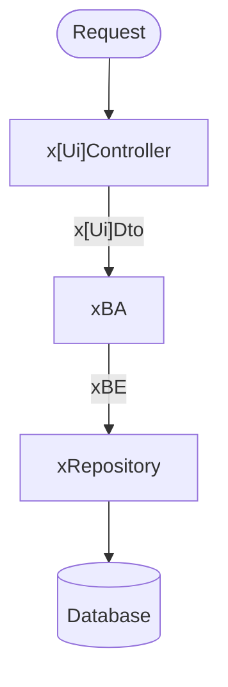

# Class and package structure

## BCE-Pattern explanation

- **Boundary:**
Interface to the outside of the application.
Contains all api-endpoints. When the endpoint is for the frontend it is named
xUiController and offers xUiDTOs.

- **Servie (Control):** 
Contains all service (xBA) classes. 
They implement the logic to transform a xUiDTO into the (xBE).
Only place where the equally named xBE should be written to the DB.
This ensures that all BE concerning logic is at one place.
To reduce boilerplate of simple DTO → BE mapping use mapstruct. 

- **Entity:** 
Contains all entity (BE) classes. They represent DB-tables managed by Hibernate.
 
## Data flow:

A request passes through the following layers before it is persisted.

### Layers

| Layer | Input | Output | Responsibility |
|---|---|---|---|
| **xUiController** | Request | `x[Ui]Dto` | Passes the `x[Ui]Dto` to the correct `xBA`. Contains no logic. |
| **xBA** | `x[Ui]Dto` | `xBE` | Transforms the `x[Ui]Dto` into the correct `xBE` and applies the business logic. |
| **xRepository** | `xBE` | – | Saves the `xBE` to the database. |
| **Database** | – | – | Persistent storage. |

### Glossary
- Ui = User Interface
- DTO = Data Transfer Object
- BA = Business Authority
- BE = Business Entity