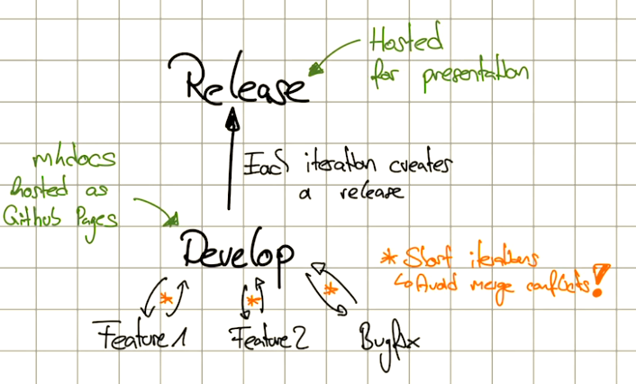

# Git Strategy

We follow a similar strategy to the [Git-Flow](https://www.atlassian.com/git/tutorials/comparing-workflows/gitflow-workflow) strategy.

- **develop:**
    Global development state.
    All developers develop on feature/bugfix branches and merge them back
    into develop when finished.
    
    It is important to merge feature often into dev. This avoids merge conflicts!

- **release:**
    After each iteration the development state is frozen on the release branch.
    Then it can be hosted for presentation.