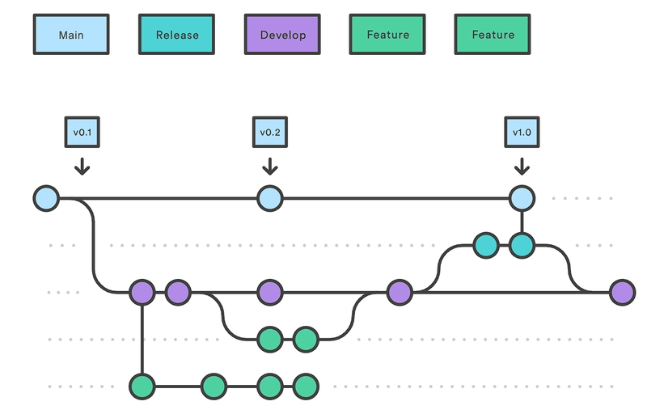

# Git Strategy

We follow the [Git-Flow](https://dev.to/karmpatel/git-branching-strategies-a-comprehensive-guide-24kh) strategy.

- **main:** 
    Currently released version. Hosted via CI/CD pipeline

- **release:**
    Not really necessary for such a small project.
    Only use it for large releases when development on dev continues
    while still some features are missing for the release.
    (Missing features are cherry picked)

- **develop:**
    Global development state.
    All developers develop on feature/bugfix branches and merge them back
    into develop when finished.
    Current develop state is also hosted via CI/CD pipeline.