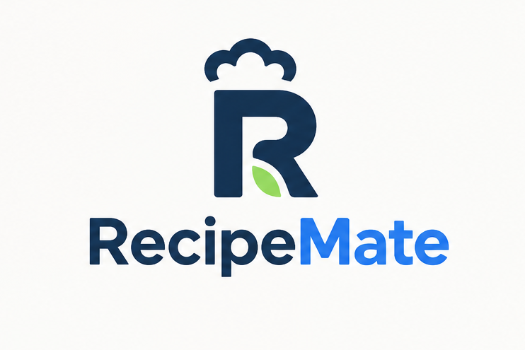

# RecipeMate

RecipeMate is a recipe management app that brings all your recipes into one consistent format, from your own creations
to dishes found anywhere on the web.
Import a recipe from any source, refine it with AI assistance, plan your week, and cook step by step with guided
instructions.
Share your favourites with family, friends or the whole community, and discover new dishes along the way.

## Why RecipeMate?

### One format for every recipe

No more inconsistent, cluttered recipes scattered across countless websites.
RecipeMate defines a unified recipe schema, and its AI-powered universal import converts any recipe (a URL, pasted text
or a photo) into that format automatically.

### From recipe to dinner table

Recipes are meant to be cooked, not just collected.
Assign recipes to the days of your week, and RecipeMate generates your shopping list automatically, taking much of the
planning off your plate.

### Cooking is a shared experience

Connect with friends, family or the entire community.
Share, rate and comment on recipes, and find your next favourite dish in a personalised feed.

---

## Links

Here are all links to the project's documentation.

### Planning

- [Features](planning/features.md)
- [Data model](planning/data-model.md)

### Conventions

- [Git usage](conventions/git-usage.md)
- [AI agent usage](conventions/ai-agent-usage.md)
-
Backend: [Techstack](conventions/backend/techstack.md) · [BCE pattern and data flow](<conventions/backend/BCE-Pattern und Data Flow.md>)
- Frontend: [API usage](conventions/frontend/api-usage.md) · [Design system](conventions/frontend/design-system.md)
