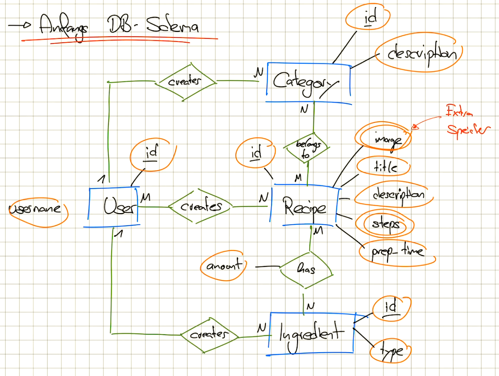

## Important aspects:

- A `Step` can be of different methods such as *prepare, cook, bake...*.
  According to the method are different optional parameters required.
  For example a timer and grad Celsius for a *bake-step*

  → Implement this via discriminator columns and inheritance in Hibernate.

- Ingredients are standing data. If the user needs special ingredients,
  he can add a custom ingredient to the recipe. It is only saved for this recipe alone.