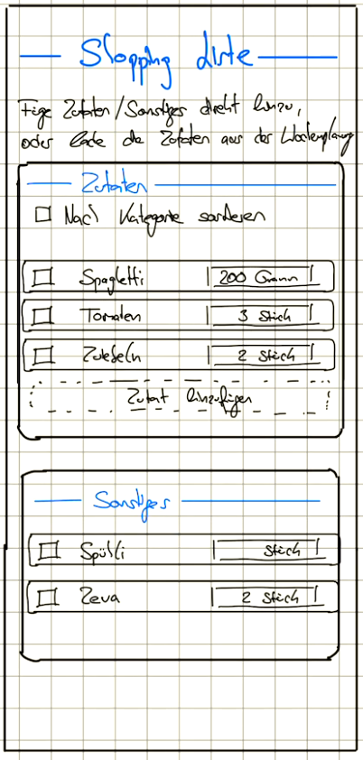
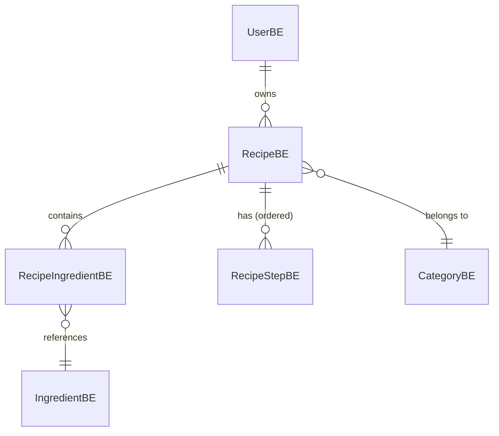

# Recipe management

**Release:** MVP · **Priority:** Must · [**Epic**](https://github.com/Luitzzi/RecipeMate/issues/2)

## Goal

Users create, edit and organize their own recipes.

The user can quickly find a recipes via filters.

The user can add ingredients directly from a recipe to the shopping list

## Pages

- **Recipe Creation**

- **Recipe List**

- **Shopping List**

### Reusable components
- The recipe list can be reused when selecting a recipe for a day in meal prepping

### Ui Drafts

- **Recipe creation:**

{ width="200" }

- **Recipe List**

{ width="600" }

- **Shopping List**

{ width="150" }

## User stories

- **Recipe creation:**

- **Recipe List**

- **Shopping List**

## Domain model

| Entity | Key fields | Notes |
|---|---|---|
| `RecipeBE` | id, name, description, servings, prepTimeMinutes, cookTimeMinutes, category, owner, sourceUrl, createdAt, updatedAt | `sourceUrl` is set for imported recipes. |
| `RecipeIngredientBE` | id, recipe, ingredient, quantity, unit, note, position | `note` for free text such as "finely chopped". |
| `IngredientBE` | id, name, defaultUnit, shelfLifeDays | Master data. Required for ingredient search and shopping list aggregation. `shelfLifeDays` is used by meal planning. |
| `RecipeStepBE` | id, recipe, position, instruction, durationMinutes | `durationMinutes` is optional and used by the cooking mode timer. |
| `CategoryBE` | id, name | Alternatively an enum; decide in ADR. |

**Key decision:** Ingredients are structured (quantity + unit + reference to `IngredientBE`), not free text. Without this, ingredient search (RM-6) and the shopping list cannot be built reliably.

## Business logic (`RecipeBA`)

- Only the owner may edit or delete a recipe.

## Out of scope

- AI import and chatbot (see [AI recipe assistance](ai-recipe-assistance.md))
- Sharing and groups (see [Sharing & feed](sharing-and-feed.md))

## Open questions

- How to manage the ingredient standing data?
- What exactly are categories and how defines them?
- Multiple categories/tags per recipe?
- Unit conversion (g ↔ kg, ml ↔ l) at entry time or only when aggregating? 
    → Only normal units
- Where are photos stored (DB, file system, object storage)?