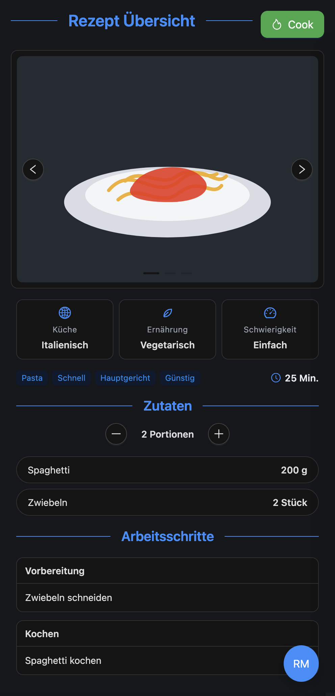

**Release:** MVP · **Priority:** MUST · [**Epic**]()

## Goal
Presenting all the necessary information about one single recipe to the user. This includes:
- Displaying one or multiple images of the finished meal.
- Displaying all included ingredients and there quantities
- Displaying all the necessary steps
- Displaying all the tags and the cuisine

Show the user a button to start cooking the recipe.

## Ui Drafts
{ width="150" }
{ width="150" }

## Features
- [ ] Cycling through the recipe images

## Open questions