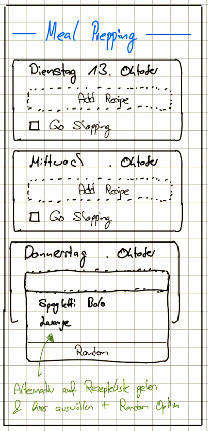

**Release:** TODO · **Priority:** TODO · [**Epic**]()

## Goal
Let the user plan which of their recipes they cook on which day of the week. This includes:
- A week view with one card per day
- Adding one or multiple existing recipes to a day, by search or randomly
- Marking the days on which the user goes shopping

The plan is saved per user, so it is available on every device.

## Ui Drafts
{ width="150" }
{ width="150" }

## Features
- [x] Week view (Monday – Sunday) with navigation to the previous / next week and back to today
- [x] Highlighting today
- [x] Summary of the week: planned meals and shopping trips
- [x] Adding a recipe to a day via a searchable recipe list
- [x] Adding a random recipe (out of the current search results)
- [x] Removing a recipe from a day
- [x] "Go Shopping" flag per day
- [x] Persisting the plan per user (`/api/prepping`)

## Open questions
- Should the shopping list be generated from the recipes planned until the next shopping day? (see [Shopping list](shopping-list.md))
- Servings per planned recipe?
- Free text entries for days without a recipe (e.g. leftovers, eating out)?
- Creating a new recipe directly from the planner?
