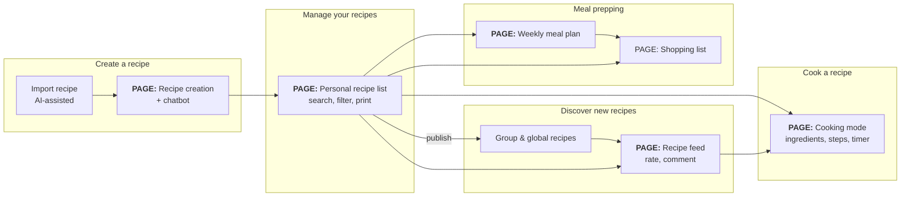

# Features

This section describes **what** RecipeMate does and **why**.

The current work status lives in the [GitHub Project](https://github.com/users/Luitzzi/projects/9), not here.
Each feature page links to its epic issue, and each epic links back to its page.

## Feature Overview

| Feature | Release | Priority | Spec | Epic |
|---|---|---|---|---|
| Recipe management | MVP | Must | [Recipe management](/planning/epic-description/recipe-management/) | [Epic](https://github.com/Luitzzi/RecipeMate/issues/2) |
| Cooking mode | MVP | Must | [Cooking mode](cooking-mode.md) | [Epic](https://github.com/Luitzzi/RecipeMate/issues/3) |
| AI recipe assistance (import + chatbot) | V1 | Should | [AI recipe assistance](ai-recipe-assistance.md) | [Epic](https://github.com/Luitzzi/RecipeMate/issues/1) |
| Meal planning & shopping list | V1 | Should | [Meal planning](meal-planning.md) | #TODO |
| Ingredient and category standing data and associate management | V2 | Should | #TODO | #TODO |
| Sharing, groups & feed | V2 | Could | [Sharing & feed](sharing-and-feed.md) | #TODO |

## Release plan

| Release | Goal | Scope |
|---|---|---|
| **MVP** (Minimum viable product) | A single user can manage and cook their own recipes. | Recipe management, cooking mode (without chatbot, without statistics) |
| **V1** | Faster recipe entry and weekly planning. | AI import, chatbot, meal planning, meal prepping -> shopping list |
| **V2** | Recipes are shared and discovered. | Authentication, User-Accounts, Groups, publishing, feed, ratings, comments |
| **Later** | Personalisation and gamification. | Preference algorithm, cooking-time competition, browser extension |

## User journey (story map)

### Pages

| Page | Description | Ui-Draft | Target device |
| --- | --- | --- | --- |
| **Recipe creation** | User can create a recipe. |  | Laptop / Mobile   |
| **Recipe List** | Search and Filterable overview over the user's own and subscribed recipes. Focus is on overview over recipes.|  | Mobile |
| **Recipe Feed** | Search and Filterable overview over all recipes. Focus is on discovering new recipes fitting to the user's preferences |  | Mobile |
| **Cooking Mode** | User can cook a recipe following a controlled structure. Checkboxes for ingredients/steps. |  | Mobile / Tablet|
| **Meal Prepping** | User can add recipes to the days of the week. He can select the days he want to go shopping -> A shopping list is generated |  | Mobile / Laptop |
| **Shopping List** | Ingredients can be added directly from an recipe, or from the meal prepping page. The user can add free-text non ingredients (exp. Spühli...) too. |  | Mobile |

## Requirements

### Functional Requirements

- **Consistent design system:** 
    We use [Ant Design](https://ant.design/) as the design system.
    They offer predefined components. All styling aspects are predefined in tokens.ts.
    For more information see [Design system docs](/conventions/frontend/design-system/)

- **Dark-Mode:** The app is available in a light and dark mode.

### Non-functional Requirements

- **Security:**
  Dedicated login provider. Should be easy to integrate more applications (HolidayMate, InventoryMate)

  → OAuth 2.0, (Keycloak?)

- **Responsive design:** 
    The pages must be mobile first. However, pages like Recipe-Creation/List and the cooking page must also look good on tablets and desktop devices.

- **Internationalisation:**
  Translation (German, English) of the UI as well as automatic translation of recipes.

  → Frontend translation: i18next

  → Backend automatic recipe translation: TODO

- **Visible project state:**
    The current state of the development and docs should be always accessible.

    → Automatic deployment of mkdocs via CI/CD Pipeline
    → Manual deployment on Johannes's server for presentation purposes