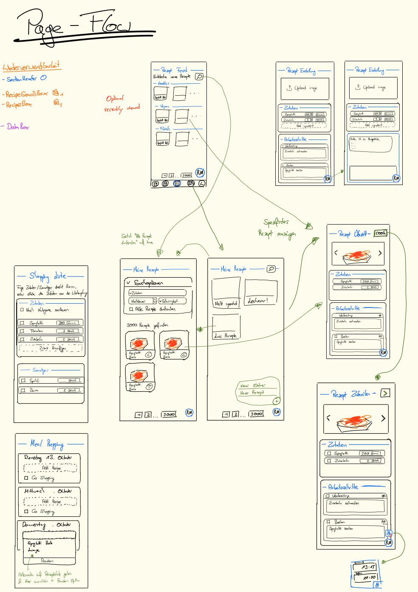
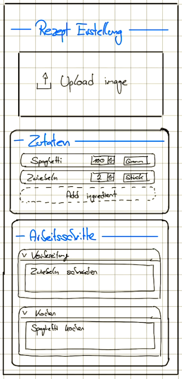
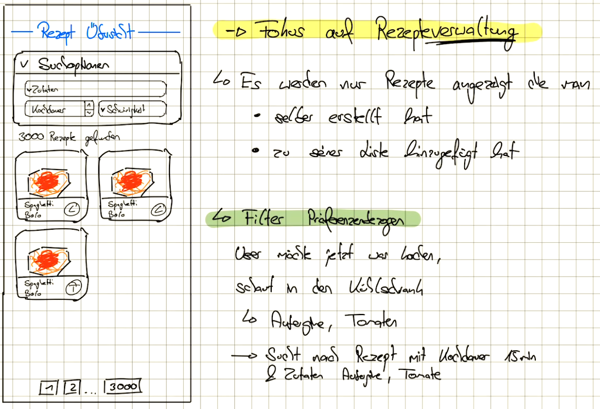
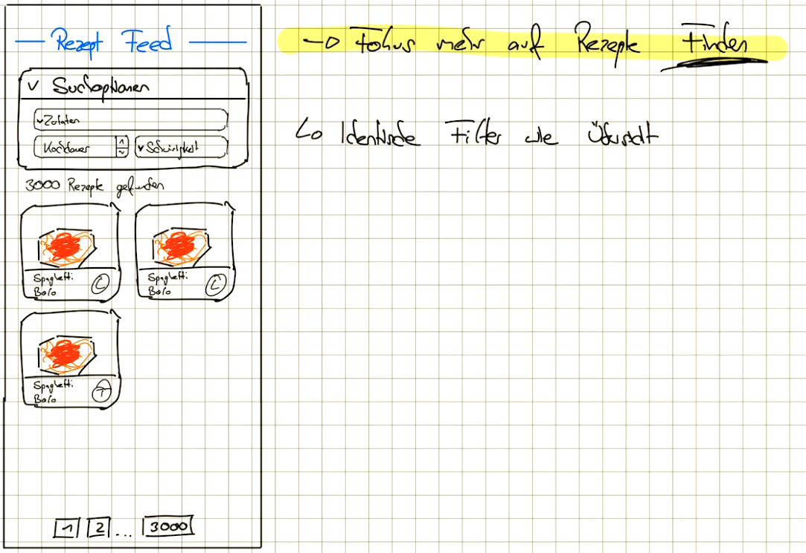
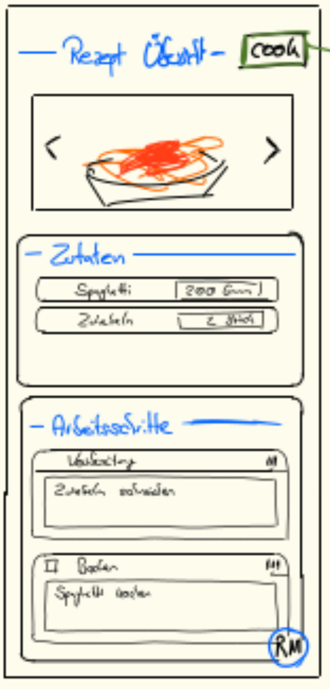
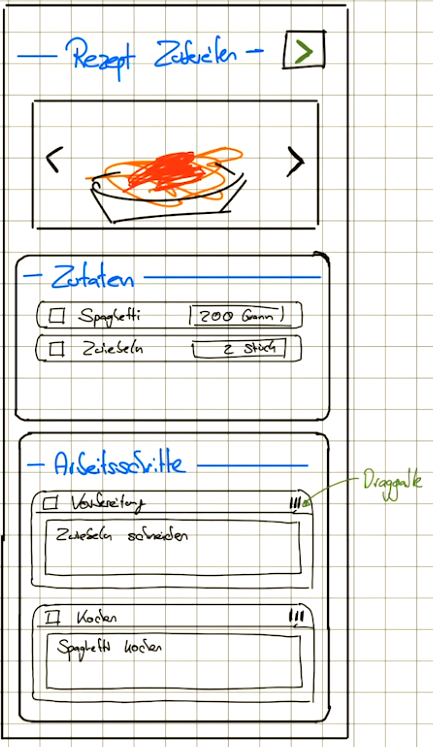

# Features

This section describes **what** RecipeMate does and **why**.

The current work status lives in the [GitHub Project](https://github.com/users/Luitzzi/projects/9), not here.
Each feature page links to its epic issue, and each epic links back to its page.

## Feature Overview

| Feature                        | Release | Priority | Spec                     | Epic                                                   |
|--------------------------------|---------|----------|--------------------------|--------------------------------------------------------|
| Page: Rezepte Erstellung       | MVP     | Must     | -                        | -                                                      |
| Page: Meine Rezepte            | MVP     | Must     | -                        | -                                                      |
| Page: Rezepte Übersicht        | MVP     | Must     | -                        | -                                                      |
| Page: Rezepte Zubereitung      | MVP     | Must     | -                        | -                                                      |
| Page: Rezepte Feed             | -       | Must     | -                        | -                                                      |
| Page: Meal prepping            | -       | Should   | -                        | -                                                      |
| Page: Shopping Liste           | -       | Should   | -                        | -                                                      |
| Page: Profile Page             | -       | Must     | -                        | -                                                      |
| AI recipe assistance - Chatbot | -       | Must     | [AI recipe assistance]() | [Epic](https://github.com/Luitzzi/RecipeMate/issues/1) |
| AI recipe assistance - Plugins | -       | Should   | [AI recipe assistance]() | [Epic](https://github.com/Luitzzi/RecipeMate/issues/1) |
| Sharing, groups & feed         | -       | Could    | -                        | -                                                      |

## Release plan

| Release                              | Goal                                                                          | Scope                                                                                                                     | Link                               |
|--------------------------------------|-------------------------------------------------------------------------------|---------------------------------------------------------------------------------------------------------------------------|------------------------------------|
| **MVP** (Minimum viable product) | A single user can create, manage and cook recipes. He can ask a basic chatbot | **Pages:** Recipe Creation, Recipe List, Recipe Display, Recipe cooking   **Else:** Basic chatbot, Profile Page Draft | [Details](../releases/mvp-release) |

## Page flow

### Pages

| Page                    | Description                                                                                                                                        | Ui-Draft                                                                   | Target device   |
|-------------------------|----------------------------------------------------------------------------------------------------------------------------------------------------|----------------------------------------------------------------------------|-----------------|
| **Rezepte Erstellung**  | User can create a recipe.                                                                                                                          | { width="150" } | Laptop / Mobile |
| **Meine Rezepte**       | Search and Filterable overview over the user's own and subscribed recipes. Focus is on overview over recipes.                                      | { width="600" } | Mobile          |
| **Rezepte Feed**        | Search and Filterable overview over all recipes. Focus is on discovering new recipes fitting to the user's preferences                             | { width="600" }     | Mobile          |
| **Rezepte Übersicht**   | Overview over the recipe and its elements                                                                                                          | { width="150" }         | Mobile          |
| **Rezepte Zubereitung** | User can cook a recipe following a controlled structure. Checkboxes for ingredients/steps.                                                         | { width="150" }  | Mobile / Tablet |
| **Meal Prepping**       | User can add recipes to the days of the week. He can select the days he want to go shopping -> A shopping list is generated                        | { width="150" }   | Mobile / Laptop |
| **Shopping List**       | Ingredients can be added directly from an recipe, or from the meal prepping page. The user can add free-text non ingredients (exp. Spühli...) too. | { width="150" }   | Mobile          |
| **Profile Page**        | TODO                                                                                                                                               | TODO                                                                       | Mobile          |

## Requirements

### Functional Requirements

- **Consistent design system:**
  We use [Ant Design](https://ant.design/) as the design system.
  They offer predefined components. All styling aspects are predefined in tokens.ts.
  For more information see [Design system docs](/conventions/frontend/design-system/)

- **Dark-Mode:** The app is available in a light and dark mode.

### Non-functional Requirements

- **Security:**
  Dedicated login provider. Should be easy to integrate more applications (HolidayMate, InventoryMate)

  → OAuth 2.0, (Keycloak?)

- **Responsive design:**
  The pages must be mobile first. However, pages like Recipe-Creation/List and the cooking page must also look good on
  tablets and desktop devices.

- **Internationalisation:**
  Translation (German, English) of the UI as well as automatic translation of recipes.

  → Frontend translation: i18next

  → Backend automatic recipe translation: TODO

- **Visible project state:**
  The current state of the development and docs should be always accessible.

  → Automatic deployment of mkdocs via CI/CD Pipeline
  → Manual deployment on Johannes's server for presentation purposes