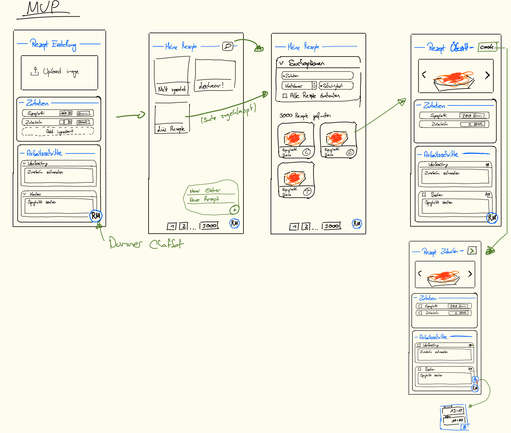

## Contains

First release containing the minimal viable product.

**Goal:**
Have a working app implementing the absolut basics.
From there product can be evaluated and the next steps planned accordingly.

### Tasks per person:

**Luis:**

- Implemented xy

### Page-Flow

## Open Questions

- **Domain model:**

- What infos does a recipe have? (stars, category, time etc.)

  -> Defined in RecipeEntity

- What recipe categories do we have and how do we structure them? Vegan, vegetarian etc. / Breakfast, Lunch ...

  -> Defined in Enum RecipeProperty

- What information do we track for ingredients? (vegetable, meat etc.)

  -> Column "Type" for Diet and "Allergies" to track Allergies

- **Data Schema:**

  → Transform the domain model into a db schema

- How do we want save ingredients? Freetext / standing data

  → Both: There is a set with standing data, providing suggestions, however, if the ingredient is not in the set the
  user can add it.
  Then the ingredient is just saved for the recipe.

## Evaluation

- Domain Model was created
- Discussed UI-Drafts for all Pages
- Implemented UI-Drafts
- Implemented Chat functionality
- Implemented Object Storage for Images

We started fast creating a well defined structure using mkdocs.

We defined patterns for the backend (BCE orientated) and frontend design guides.

The implementation took a bit longer than anticipated, however, we have a working first draft now.