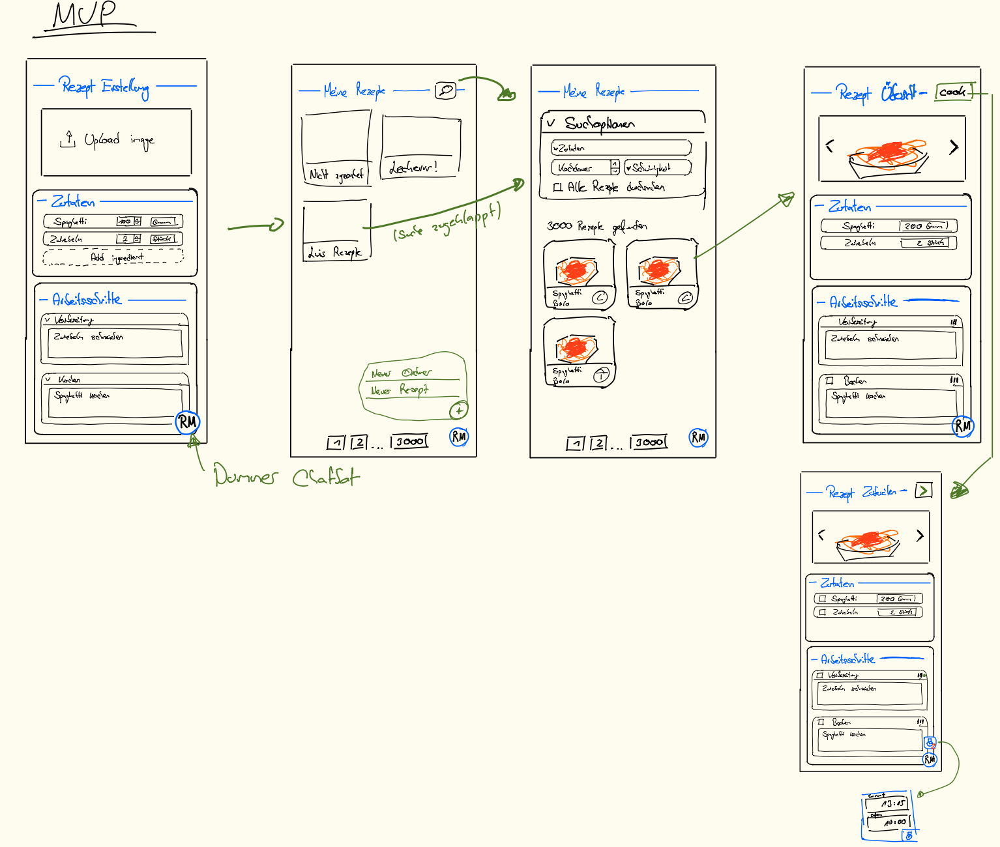

## Contains

First release containing the minimal viable product.

**Goal:**
Have a working app implementing the absolut basics.
From there product can be evaluated and the next steps planned accordingly.

### Page-Flow

## Open Questions

- **Domain model:**

    - What infos does a recipe have? (stars, category, time etc.)

    - What recipe categories do we have and how do we structure them? Vegan, vegetarian etc. / Breakfast, Lunch ...

    - What information do we track for ingredients? (vegetable, meat etc.)

- **Data Schema:**

  → Transform the domain model into a db schema

    - How do we want save ingredients? Freetext / standing data

  → Both: There is a set with standing data, providing suggestions, however, if the ingredient is not in the set the
  user can add it.
  Then the ingredient is just saved for the recipe.