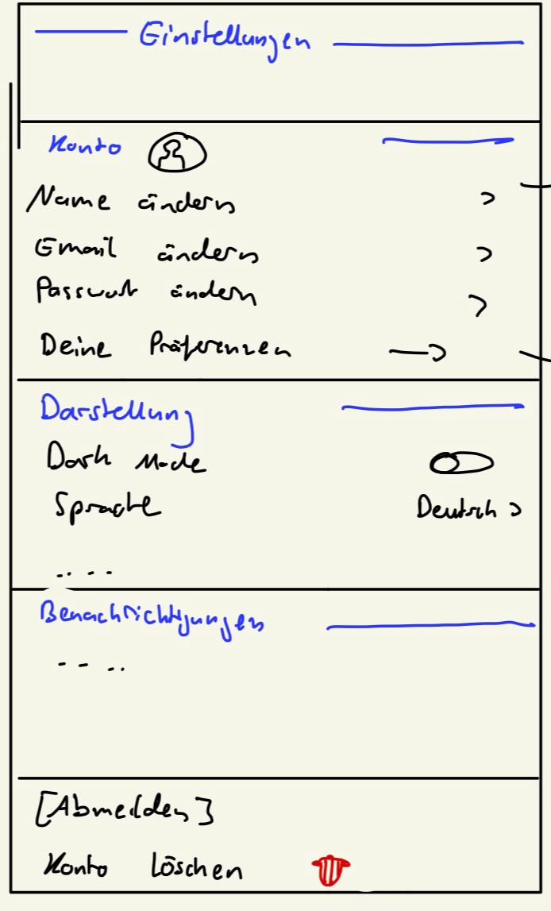
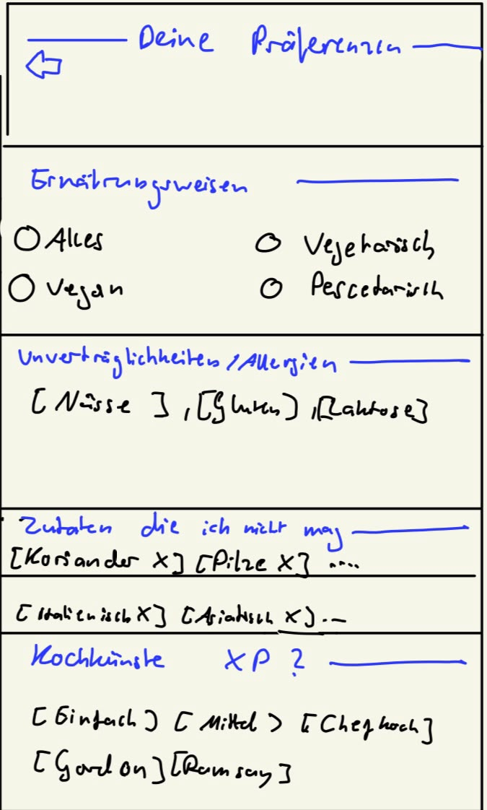
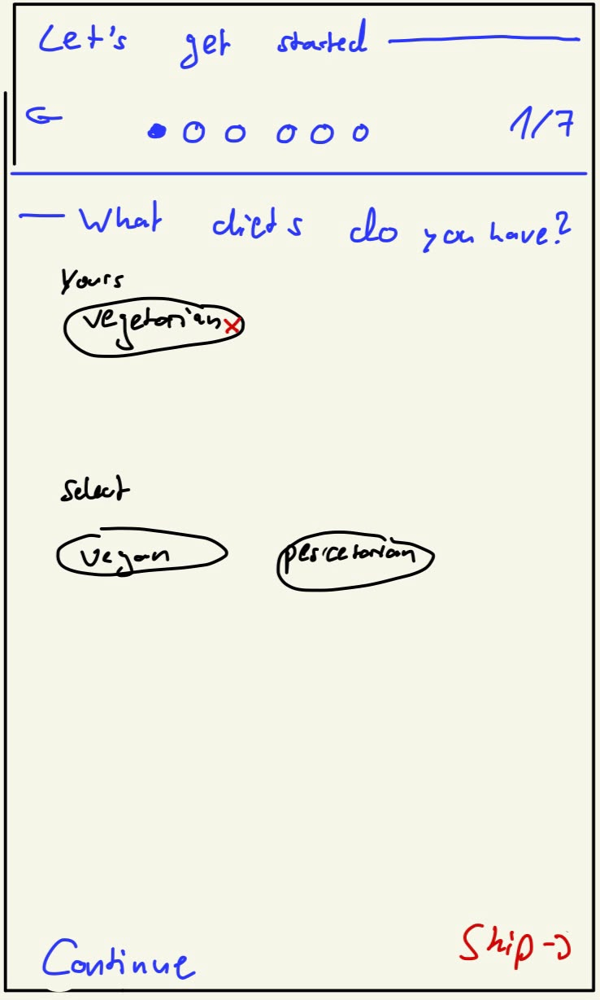

# Ui planning

Here live all the broad UI-plans.

The specific UI-planning happens in the epics found in the [project-specifications](../project-specifications)

## Page flow

### Pages

| Page                    | Description                                                                                                                                        | Ui-Draft                                                                    | Target device   |
|-------------------------|----------------------------------------------------------------------------------------------------------------------------------------------------|-----------------------------------------------------------------------------|-----------------|
| **Rezepte Erstellung**  | User can create a recipe.                                                                                                                          | { width="150" }  | Laptop / Mobile |
| **Meine Rezepte**       | Search and Filterable overview over the user's own and subscribed recipes. Focus is on overview over recipes.                                      | { width="600" }  | Mobile          |
| **Rezepte Feed**        | Search and Filterable overview over all recipes. Focus is on discovering new recipes fitting to the user's preferences                             | { width="600" }      | Mobile          |
| **Rezepte Übersicht**   | Overview over the recipe and its elements                                                                                                          | { width="150" }          | Mobile          |
| **Rezepte Zubereitung** | User can cook a recipe following a controlled structure. Checkboxes for ingredients/steps.                                                         | { width="150" }   | Mobile / Tablet |
| **Meal Prepping**       | User can add recipes to the days of the week. He can select the days he want to go shopping -> A shopping list is generated                        | { width="150" }    | Mobile / Laptop |
| **Shopping List**       | Ingredients can be added directly from an recipe, or from the meal prepping page. The user can add free-text non ingredients (exp. Spühli...) too. | { width="150" }    | Mobile          |
| **Settings Page**       | Users can view and update their personal information and app settings.                                                                             | { width="150" }     | Mobile          |
| **Preferences Page**    | Users can view and manage their preferences.                                                                                                       | { width="150" } | Mobile          |
| **Start Page**          | New users answer a few questions to personalize their app experience.                                                                              | { width="150" }       | Mobile          |